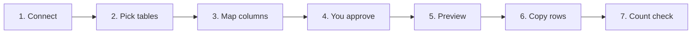

# DataSphere Migration Studio

**A web app that copies tables from one database to another — after a person maps the columns and says yes.**

You point it at a **source** database and a **target** database. It reads the table structure, suggests which columns match, and waits for you. It never invents mappings with AI, never talks to a cloud LLM, and never writes data until you approve and confirm.

| | |
|---|---|
| **What it is** | A local Java web application (Spring Boot) you run on your machine |
| **What it copies** | Rows, with `INSERT` only — into tables that already exist |
| **What it does not do** | Drop, truncate, overwrite, or auto-create tables on the target |
| **Who reviews** | You. Scores are a rule of thumb, not a probability |

**Repository:** https://github.com/venkates98/DATASPHERE-MIGRATION-STUDIO

---

## In one picture



| Step | You do this | The app does this |
|---|---|---|
| **1. Connect** | Enter host, port, user, password for source and target | Tests the connection. Password stays in memory, never on disk |
| **2. Pick tables** | Choose which source table goes to which target table | Lists schemas and tables it discovered |
| **3. Map columns** | Review suggestions; accept, change, or reject | Scores names and types with **fixed rules** (same input → same result) |
| **4. Approve** | Tick the confirmation and approve | Locks that mapping version on the **server** |
| **5. Preview** | Read the INSERT / CREATE TABLE text | **Writes nothing** |
| **6. Copy** | Confirm writes | Inserts in batches. You can cancel between batches |
| **7. Check** | Run validation | Compares row counts. Result is **partial**, never “100% correct” |

If you change the mapping or the live table structure, approval is withdrawn. Migration cannot start by itself.

---

## What databases?

Any **registered** source with any **registered** target (including same product → same product):

| Product | Default port | Note |
|---|---|---|
| Microsoft SQL Server | 1433 | |
| Oracle Database | 1521 | **Service name** only (not SID, not TNS) |
| PostgreSQL | 5432 | |
| MySQL | 3306 | Database name is also the schema |

MariaDB, DB2 and SQLite are **not** included.

> **Honest status:** every pair is **PARTIAL SUPPORT**. Automated tests use in-memory H2 stand-ins, not live vendor servers. Use this as a guided copier on your own databases, then verify the result yourself.

---

## Run it in two minutes

You need **JDK 17+** and **Maven 3.9+**.

```powershell
.\run-dev.ps1
```

Open http://localhost:8080 and sign in.

Then: **Migration Projects** → create a project → follow the five-step workspace (Connections → Tables → Mapping → Approve → Preview / Start).

**Full click-by-click walkthrough:** [User guide](docs/USER-GUIDE.md)  
(same content as **Help & Documentation** inside the app)

The `dev` profile is for **your machine only**. The local admin password is stored as a BCrypt hash, never as plain text.

---

## How column suggestions work (no AI)

The engine only looks at **metadata**: names, types, length, precision, scale, nullability, PK / FK / unique. It does **not** read row values to decide a mapping.

| Clue | Weight (must total 100) |
|---|---|
| Exact name (ignores case and `_` vs camelCase) | 40 |
| Abbreviation / synonym dictionary | 25 |
| Name similarity (supporting evidence only) | 15 |
| Data type compatibility | 10 |
| Length / scale fit | 5 |
| Constraints (PK, FK, unique, nullable) | 5 |

**How to read the score**

- Bands: **90–100** high · **75–89** good · **50–74** needs review · **below 50** weak
- It is **not** a probability. An exact name match can hit 100. An abbreviation like `EMP_NM` → `EMPLOYEE_NAME` cannot earn the “exact” 40 points, so it often lands around 60 — **Suggested** but still *needs a person*.
- Close runners-up stay **Needs review**; the app will not pick for you.
- Incompatible types are blocked unless you choose a conversion.

Weights live in `application.properties` (`datasphere.mapping.*`). The dictionary is `src/main/resources/mapping/abbreviations.properties` (or your own file).

---

## Safety, in plain words

- **You approve on the server**, not just by clicking a button that looks enabled.
- Approval is tied to the mapping version plus a fingerprint of source and target structure. Change either → approval is gone.
- Generated SQL uses quoted identifiers and `?` placeholders. Nobody can type arbitrary SQL in the browser.
- No code path `DROP`s, `TRUNCATE`s, `DELETE`s, or overwrites target rows.
- Target tables must **already exist**. The app can *show* `CREATE TABLE` text; it does not apply it.

---

## Run locally (more detail)

```powershell
.\run-dev.ps1
# same as:
mvn spring-boot:run "-Dspring-boot.run.profiles=dev"
```

**From Eclipse:** run `DataSphereMigrationStudioApplication`. Working directory should be the project root so it can read the git-ignored `.env`. If that file is missing, startup stops with “No administrator configured” — on purpose. `DevApplication` (under `src/test`) turns on the `dev` profile and is never packed into the production jar.

### Your own administrator (not `dev`)

Copy [`.env.example`](.env.example). Put a **BCrypt hash**, never a plain password:

```powershell
$env:DATASPHERE_ADMIN_USERNAME = "your-admin"
$env:DATASPHERE_ADMIN_PASSWORD_HASH = '{bcrypt}$2a$12$...your hash...'   # single quotes: the hash contains $
mvn spring-boot:run
```

Startup fails if the hash is not BCrypt, or if `dev` and `prod` are both on.

### Build and test

```powershell
mvn clean test          # 242 tests, no external database required
mvn clean package
java -jar target\datasphere-migration-studio-0.1.0-SNAPSHOT.jar --spring.profiles.active=prod
```

---

## Configuration

| Variable | Purpose |
|---|---|
| `DATASPHERE_DATA_DIR` | Where projects are saved (default `./data`, git-ignored) |
| `DATASPHERE_DB_ALLOWED_HOSTS` | Host allow-list for DB connections. **Required in `prod`.** |
| `DATASPHERE_ADMIN_USERNAME` / `DATASPHERE_ADMIN_PASSWORD_HASH` | Admin (BCrypt only) |
| `DATASPHERE_COOKIE_SECURE` | Secure session cookie (`prod` forces this) |

Project JSON files store hosts and user names **without passwords**. After a restart you type passwords again. Protect `./data` with file permissions.

---

## REST API

All calls need a logged-in session. Writes need the CSRF token.

| Call | Purpose |
|---|---|
| `POST /api/connections/{role}/test` | Test source or target without saving |
| `POST/GET /api/projects`, `GET/DELETE /api/projects/{id}` | Projects |
| `PUT /api/projects/{id}/connections/{role}` | Test and save a connection |
| `GET /api/projects/{id}/schema/{role}/schemas\|tables\|columns` | Discovery |
| `POST .../tables/suggest`, `PUT .../tables` | Suggest and save table pairs |
| `POST .../metadata/refresh` | Re-read structure and reconcile mapping |
| `GET/PUT /api/mapping/{id}` | Read / change mapping |
| `POST /api/mapping/{id}/suggest\|validate\|approve` | Suggest, validate, approve |
| `GET /api/databases`, `GET /api/compatibility` | Adapter list and pair matrix |
| `POST /api/migration/{id}/preview` | Read-only preview |
| `POST /api/migration/{id}/start` | Batch INSERT after `confirmWrite: true` |
| `POST .../cancel`, `GET .../status` | Cancel between batches; job status |
| `POST /api/migration/{id}/validate` | Post-copy counts (partial) |

---

## What this build does not do yet

- Apply generated `CREATE TABLE` on the target (you create tables first)
- Resume a composite primary key from the last key (restart the table; skip duplicates)
- Upsert / overwrite existing target rows (intentionally omitted)
- Prove two tables are byte-for-byte equal, or run Testcontainers against real vendor servers
- MariaDB, DB2, SQLite
- A durable job-history screen (runs sit on the project JSON; dashboard counters are in memory)

**Other limits:** IPv6 hosts are not supported. Mapping is a heuristic (`STATUS` vs `STATE` can look alike). Preview `COUNT(*)` is a snapshot. There is a single administrator. The UI is Thymeleaf + vanilla JS (checked in one browser, not with automated UI tests).

---

## Before you put it on a real server

- [ ] Never run `dev` outside your laptop (`dev` + `prod` together is refused)
- [ ] Admin from a secret store: username + **BCrypt** hash
- [ ] HTTPS + `prod` profile (Secure cookies)
- [ ] Set `DATASPHERE_DB_ALLOWED_HOSTS` and restrict outbound network too
- [ ] Read-only account on the source; INSERT-only (no DROP) on the target
- [ ] Lock down `./data` and `./logs`
- [ ] Reverse proxy / firewall so only the right people can open the app

---

## Where the code lives

```
com.datasphere.migration
  db         adapters, dialects, drivers, connections, host policy
  metadata   JDBC discovery and fingerprints
  mapping    name / abbreviation / scoring, type conversion
  engine     batch INSERT, checkpoints, cancel
  validation post-copy counts
  project    workflow, approval, migration gate, JSON persistence
```

Templates and static CSS/JS live under `src/main/resources`.
